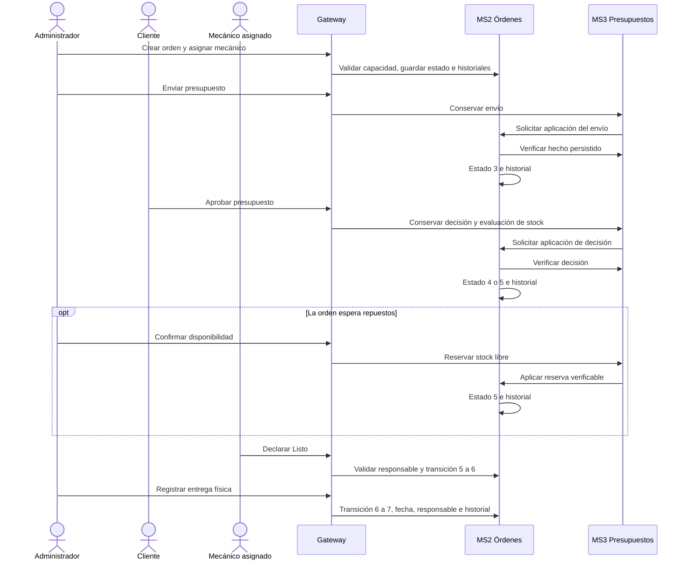

# Secuencia completa del ciclo de una orden

Semana 8 · SCRUM-524 / SCRUM-708

## Alcance y fuentes

La sistematización final, secciones 4.1 a 4.3 y 4.6 a 4.9, define ocho estados
de orden. La situación de una versión de presupuesto, una solicitud o un aviso
no agrega estados a ese catálogo. Esta guía conecta las operaciones existentes
con ese ciclo y señala las etapas que todavía no tienen una operación completa.

Fuentes técnicas: [máquina de estados](maquina-estados-ordenes.md),
[contratos de la Gateway](contratos-api-gateway.md), routers y servicios de
MS2/MS3 y [estudio de consultas históricas](estudio-consultas-historicas.md).
Web y móvil usan `/api/*` en la Gateway. Las llamadas MS2–MS3 son internas:
ningún cliente modifica directamente tablas de otro dominio.

## Preparación de una atención

El Cliente registra su cuenta y vehículo. El Administrador configura la
capacidad por mecánico y el cupo diario de ingresos físicos con los contratos
`/api/ordenes/configuracion/capacidad/mecanicos` y
`/api/ordenes/configuracion/capacidad/ingresos-diarios` (PUT).

La orden puede nacer sin mecánico. El cupo diario cuenta ingresos físicos de la
jornada del taller, no órdenes; reutilizar un ingreso abierto no consume otro
cupo. La capacidad del mecánico cuenta órdenes asignadas que no estén
`Entregado` ni `Cancelado`; `Listo` todavía ocupa capacidad. La asignación remota
debe conservar el contrato pendiente de validación de usuario/rol con MS1:
no se comprueba consultando directamente su base.

## Recorrido normal y alternativa de espera

Todos los pasos requieren JWT. En esta tabla, `p` es el ID del presupuesto y
`n` el número de su versión; se usan los IDs retornados, no valores fijos.

| Paso | Actor y operación pública | Resultado y comprobación |
| --- | --- | --- |
| 1 | Administrador: `POST /api/ordenes`, body `{ "vehiculo_id": 12 }` | `201`, nueva orden en `Recibido` (1), ingreso nuevo o reutilizado e historial inicial en una transacción de MS2. |
| 2 | Administrador: `PUT /api/ordenes/{id}/mecanico`, body `{ "mecanico_id": 50 }` | Primera asignación: `Esperando diagnóstico` (2), responsable e historiales de estado y asignación. Una reasignación conserva el estado. El límite de capacidad puede rechazarla con `409`. |
| 3 | Mecánico o Administrador: `POST /api/presupuestos` con `orden_id` e `items`; ajuste por `PUT /api/presupuestos/{p}/versiones/{n}/items` | Borrador de la propuesta en MS3. Crear un presupuesto no cambia por sí solo el estado de la orden. El registro autónomo del diagnóstico no se presupone a partir de las columnas del modelo. |
| 4 | Administrador: `POST /api/presupuestos/{p}/versiones/{n}/envio` | MS3 conserva el envío; MS2 verifica el hecho y deriva `Esperando aprobación de presupuesto` (3). Solo el envío inicial produce esta transición. |
| 5a | Cliente propietario: `POST /api/presupuestos/{p}/versiones/{n}/decision`, body `{ "decision": "aprobado" }` | MS3 conserva la primera decisión y su evaluación de stock. Si alcanza, MS2 deriva `En reparación` (5); si no, `Esperando repuestos` (4). |
| 5b | Administrador, cuando la orden está en 4: `POST /api/inventario/ordenes/{id}/disponibilidad` | MS3 evalúa stock libre y conserva compromisos. MS2 verifica la reserva y deriva 4 → 5. Si falta stock responde `409`; repetir no duplica la reserva ni el historial. |
| 6 | Mecánico asignado: `PATCH /api/ordenes/{id}/estado`, body `{ "estado_destino": 6, "observacion": "Trabajo autorizado terminado" }` | Deriva `Listo` (6) y conserva actor e historial. Solo se permite desde `En reparación`. La observación es opcional en esta transición; no constituye evidencia automática del alcance terminado. |
| 7 | Administrador: `POST /api/ordenes/{id}/entrega`, sin body obligatorio | Deriva `Entregado` (7), guarda `entregado_en`, `entregado_por_id` e historial. Un reintento conserva el registro original y no duplica el historial. |

Los ítems del presupuesto distinguen `mano_de_obra` y `repuesto`. El segundo
requiere `repuesto_id`. Las versiones enviadas/aprobadas no se sobrescriben:
`POST /api/presupuestos/{p}/versiones` crea una versión nueva. Las modificaciones
posteriores tienen su propia decisión; rechazarlas conserva el alcance aprobado
y no cancela automáticamente la orden.



La Gateway reenvía el JWT. Los servicios obtienen del token al actor y verifican
rol y recurso. Las flechas entre servicios no representan una transacción global.

## Rechazo inicial y cancelación independiente

El Cliente puede rechazar el presupuesto inicial enviado mediante su endpoint
de decisión, con body:

```json
{
  "decision": "rechazado",
  "motivo": "No continuaré con el servicio",
  "confirmar_cancelacion": true
}
```

MS3 conserva el rechazo confirmado y MS2 verifica la decisión antes de derivar
3 → `Cancelado` (8). Un rechazo inicial sin confirmación o sin motivo se rechaza
con `422`. Una decisión ajena no autoriza transiciones sobre la orden.

La cancelación sin rechazar un presupuesto es un flujo distinto: el Cliente la
solicita y el Administrador confirma, comprobando que todavía no exista una
primera aprobación persistida en MS3. Ese flujo existe en `origin/Develop`, pero
no está integrado en la rama `MartinH` sobre la que se escribió esta guía.
SCRUM-522 / SCRUM-706 conserva ese pendiente de integración y verificación.
El PATCH genérico a `Cancelado` está bloqueado; enviar un motivo no lo habilita.

Las órdenes `Cancelado` y `Entregado` son terminales. Devolver físicamente un
vehículo cancelado no lo convierte en `Entregado`. Una nueva atención crea
otra orden y conserva el antecedente; los campos previstos en los modelos no
demuestran por sí solos que existan endpoints de devolución o nueva atención.

## Persistencia, errores y reintentos

- MS2 bloquea la orden al cambiar su estado y confirma estado e historial en
  una transacción local. El historial conserva estado anterior/nuevo, actor,
  origen, fecha y observación cuando corresponde. Un fallo revierte el conjunto.
- El registro del cambio también encola un evento en el outbox de MS2 en la
  misma transacción. El worker reintenta HTTP hacia MS1, que persiste el aviso
  web idempotentemente por `evento_id`. Un fallo de entrega del aviso no revierte
  el negocio. No se afirma entrega de correo o push.
- MS3 confirma sus hechos en su propia base antes de coordinar con MS2. Si la
  aplicación queda pendiente, responde `503` con la referencia y ruta de
  reintento; no corresponde volver a crear otra decisión ni otro envío.
- La aplicación del envío usa su referencia de presupuesto; la decisión usa
  `decision_id`; la disponibilidad usa `disp:{orden_id}:{version_id}`. Las
  claves se conservan para no duplicar historial al repetir la aplicación.
- `401` identifica problemas de JWT; `403`, autorización; `404`, recurso
  inexistente o no visible; `409`, conflicto de estado/capacidad/stock; `422`,
  entrada inválida; `500`, persistencia; `502`, fallo de proxy; `503`, servicio
  requerido o coordinación temporalmente no disponible. Cada endpoint publica
  su subconjunto en OpenAPI.

## Consulta y evidencia de verificación

El Cliente puede consultar el estado e historial por
`GET /api/ordenes/{id}` y `GET /api/ordenes/{id}/historial`. El historial por
vehículo usa `GET /api/ordenes/vehiculo/{vehiculo_id}/historial?limit=20&offset=0`
y conserva las atenciones anteriores con los permisos del usuario autenticado.

Las pruebas relevantes son `test_ordenes_api.py`, `test_asignacion_ordenes_api.py`,
`test_decisiones_presupuesto_integracion.py`, `test_disponibilidad_repuestos.py`
y `test_eventos_notificaciones_integracion.py`, dentro de `backend/tests/`.
SCRUM-707 agrega la secuencia finalización/entrega y el rollback de una entrega
fallida. Son comprobaciones de operaciones y contratos en entornos aislados;
no se presenta esta guía como evidencia de un despliegue integral en PostgreSQL.

Siguen pendientes la integración de cancelación y la definición de cómo acreditar
que todo el trabajo autorizado terminó antes de `Listo`. Tampoco se presume
implementación de diagnóstico, devolución o nueva atención por existir columnas
o transiciones documentadas. Ninguna de estas brechas se resuelve inventando
permisos, estados o campos controlados por el cliente.
