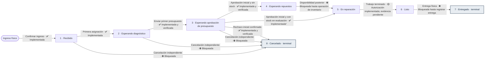

# Máquina de estados y tabla de transiciones de órdenes de trabajo

Grupo 10 · Taller de Integración II · SCRUM-313 y SCRUM-314

Este documento define el criterio técnico para validar el ciclo de vida de una
`OrdenTrabajo` en MS2. La conclusión es usar una máquina de estados finita y
explícita, implementable mediante un mapa de eventos y validadores simples. El
dominio tiene ocho estados estables y pocas transiciones respaldadas por la
Sistematización final, por lo que una librería externa de máquinas de estados no
aportaría una ventaja proporcional.

El dominio declara las transiciones estructurales en una tabla de eventos. El
PATCH genérico valida autorización y esa tabla, registra el historial de MS2 y,
desde SCRUM-436, solo permite `5 → 6` al Mecánico asignado. La asignación inicial,
el envío y la primera decisión de presupuesto se coordinan por operaciones
específicas. Los flujos sin precondiciones verificables (disponibilidad de
repuestos, entrega y cancelación independiente) quedan bloqueados en el PATCH.
La primera decisión se verifica por HTTP contra MS3, con atribución al Cliente e
idempotencia persistida por `decision_id`.

## 1. Fuentes y alcance

La fuente funcional principal es `T_integra_II/sistematizacion_final.docx`, en
especial las secciones 4.1, 4.2, 4.3, 4.6, 4.7 y 4.8. También se contrastaron:

- `T_integra_II/Diagramas_Integra_II_finales/LEEME.md`;
- el MER de MS2 en `04-mer-erd-corregido.drawio`;
- `Requerimientos.md`, requisito RF-10;
- los modelos, migraciones, servicios y pruebas actuales de MS2;
- los commits que incorporaron el catálogo, los historiales, la creación de
  órdenes y la asignación de mecánicos.

### 1.1 Discrepancia del backlog

El Excel/Jira del backlog menciona "nueve estados oficiales", pero esa cantidad
está desactualizada. La Sistematización final define expresamente **ocho estados**
y separa el estado de la orden de:

- la situación de cada versión de presupuesto;
- la revisión de una solicitud de nueva atención.

El LEEME, el MER, RF-10, los modelos y las migraciones vigentes también utilizan
los mismos ocho estados. En consecuencia, la implementación se rige por esos
ocho estados y no incorpora un noveno. La situación de una versión de presupuesto
pertenece a MS3 y no es un estado de `OrdenTrabajo`.

## 2. Infraestructura existente

El proyecto ya dispone del siguiente groundwork y debe reutilizarse:

- `models/estado_orden.py` declara los códigos constantes del 1 al 8, el mapa
  `ESTADOS_ORDEN` y `ESTADOS_TERMINALES = {ENTREGADO, CANCELADO}`.
- La migración `0003_ms2` crea y carga el catálogo `estado_orden` con exactamente
  ocho filas. La base restringe los códigos al intervalo 1–8 y hace único el
  nombre.
- `OrdenTrabajo.estado_codigo` tiene una FK local a `estado_orden`, parte en
  `RECIBIDO` y está indexado.
- `HistorialEstado` conserva orden, estado anterior, estado nuevo, actor lógico
  de MS1, origen (`usuario` o `sistema`), fecha/hora y observación. Sus estados
  tienen FK locales al catálogo y cada fila debe representar un cambio real.
- La migración `0004_ms2` refuerza la coherencia entre actor y origen: una
  transición de usuario exige `actor_usuario_id`; una de sistema no lo admite.
- `crear_orden()` crea la orden y su entrada inicial de historial
  `(sin estado anterior) → Recibido` en una sola transacción.
- `asignar_mecanico()` bloquea la orden, impide cambios sobre estados terminales
  y, en la primera asignación de una orden recibida, actualiza el responsable,
  registra `HistorialAsignacion`, cambia a `Esperando diagnóstico` y registra
  `HistorialEstado` antes del mismo `commit`.

Las FK anteriores son internas a MS2. Los identificadores de usuarios de MS1 se
mantienen como referencias lógicas, sin FK física entre bases de microservicios.

## 3. Patrón elegido para SCRUM-313

### 3.1 Por qué es una máquina de estados

Una orden no puede cambiar libremente entre valores del catálogo. Su estado
actual representa una etapa del ciclo de atención y solo ciertos hechos del
negocio permiten avanzar a otra etapa. Por ejemplo, una orden no puede entrar en
reparación sin una primera aprobación de presupuesto, y una orden terminal no
puede reabrirse.

Modelar estas reglas como máquina de estados hace explícitas tres preguntas:

1. ¿Cuál es el estado actual persistido?
2. ¿Qué evento de negocio ocurrió y se comprobaron sus precondiciones?
3. ¿Qué único estado de destino admite esa combinación?

Una lista de valores válidos protege el catálogo, pero no basta para proteger el
flujo. La tabla de transiciones de la sección 5 es la regla que limita los pares
permitidos.

### 3.2 Estado y evento no son lo mismo

Un **estado** es una condición persistente de la orden, consultable durante un
periodo: `Recibido`, `En reparación` o `Listo`.

Un **evento** es el hecho puntual que intenta producir una transición: primera
asignación, envío del primer presupuesto, aprobación, disponibilidad de
repuestos, finalización del trabajo o entrega física. El evento debe incluir o
permitir comprobar su contexto, actor y precondiciones. Registrar un diagnóstico,
por ejemplo, no cambia por sí solo la orden; el evento documentado que la lleva a
esperar la decisión del cliente es el envío del primer presupuesto.

La situación `aprobada`, `rechazada` o `pendiente` de una versión de presupuesto
es dato de MS3. Aunque una decisión pueda originar un evento para MS2, esa
situación no debe añadirse al catálogo de estados de la orden.

### 3.3 Mapa explícito y validadores simples

La tabla ejecutable se representa mediante un mapa explícito indexado por
`(estado_actual, evento)`, cuyo resultado es el `estado_nuevo`. Esta forma es
preferible a validar solo el destino, porque dos eventos distintos pueden
conducir a `Cancelado` y cada uno exige condiciones y actores diferentes.

El validador debe rechazar por defecto toda combinación ausente del mapa. Además,
cada evento debe aplicar por separado:

- autorización del actor;
- precondiciones propiedad de MS2;
- hechos informados mediante contratos de otros microservicios;
- reglas contextuales, como que todavía no exista una primera aprobación para
  cancelar por el flujo normal.

No se necesita una dependencia externa: el conjunto es pequeño, estable y
auditable; un mapa y funciones con nombres del dominio permiten comparar el
código directamente con la tabla. Una librería agregaría abstracciones y estado
interno sin eliminar la necesidad de validar permisos, presupuesto, stock,
historial y transacciones entre límites de servicio.

### 3.4 Reglas de transición y efectos externos

La validación estructural del cambio de estado está separada de sus efectos
externos. MS2 valida la transición, actualiza `OrdenTrabajo.estado_codigo` y
escribe `HistorialEstado` en una transacción local. Las operaciones de envío y
decisión verifican los hechos de MS3. El PATCH genérico no puede sustituirlas ni
ejecutar eventos que aún carecen de una operación verificadora.

Notificaciones, decisiones de presupuesto, reservas o movimientos de inventario
y otras acciones de servicios externos no deben ocultarse dentro del validador.
MS3 persiste el envío inicial o la decisión y solicita a MS2 aplicar su efecto.
MS2 consulta el hecho correspondiente en MS3 y deriva el evento con su propia
máquina. MS3 no publica un evento ni envía un destino arbitrario.

El envío inicial y la primera decisión usan coordinación HTTP con MS2. La
disponibilidad posterior de repuestos sigue pendiente.

### 3.5 Historial, actor y atomicidad

Toda transición confirmada debe producir exactamente una nueva fila de
`HistorialEstado` con:

- `orden_id`;
- `estado_anterior` y `estado_nuevo`;
- `actor_usuario_id` cuando el origen sea `usuario`;
- `origen` (`usuario` o `sistema`);
- `fecha_hora` asignada por la base;
- `observacion` cuando corresponda.

SCRUM-397 exige una observación o motivo no vacío para toda transición hacia
`Cancelado`, incluso si su origen es `sistema`. En los demás destinos sigue
siendo opcional. MS2 valida esta regla en el servicio que registra el historial;
un motivo ausente o inválido provoca rollback del cambio de estado.
El rechazo inicial exige `DecisionPresupuesto.motivo` en MS3. MS2 obtiene ese
mismo motivo mediante la consulta verificada de la decisión y lo registra en
`HistorialEstado.observacion`. Las aprobaciones no inventan una observación.

El cambio de `OrdenTrabajo.estado_codigo` y el alta del historial pertenecen a la
misma transacción local de MS2. La asignación también guarda sus cambios y su
historial dentro de la transacción local. Un error en la actualización o en el
historial exige rollback total: no puede quedar el estado sin trazabilidad ni
una historia que no corresponda al estado vigente.

Los datos de presupuesto o inventario pertenecen a otra base y no forman parte de
la transacción local de MS2. No existe una transacción única que abarque MS2 y
MS3 ni acceso directo entre sus bases.

### 3.6 Trazabilidad, auditoría y eventos de dominio

En los cambios iniciados por una persona, el actor se obtiene del usuario
autenticado por JWT. `HistorialEstado` conserva `estado_anterior`,
`estado_nuevo`, `actor_usuario_id`, `origen`, `fecha_hora` y `observacion`.
Si el origen es `usuario`, el actor es obligatorio; si es `sistema`, el actor
queda vacío. `HistorialAsignacion` conserva el mecánico anterior y nuevo, el
administrador responsable, la fecha/hora y la observación. Los IDs de usuario
apuntan lógicamente a MS1: no hay claves foráneas físicas entre bases de
microservicios.

Estos términos describen cosas relacionadas, pero distintas:

- **Historial:** registros persistidos de hechos anteriores, como cambios de
  estado o asignaciones.
- **Auditoría:** datos que permiten saber qué cambió, quién lo hizo, cuándo y,
  cuando corresponde, por qué.
- **Trazabilidad:** capacidad de relacionar esos registros con la orden y seguir
  su recorrido. `X-Request-ID` aporta correlación técnica entre una solicitud y
  los servicios que la reciben; no reemplaza el historial de dominio.
- **Evento de dominio:** hecho ocurrido en el negocio que puede ser comunicado a
  otros componentes para que reaccionen.

`EventoOrden` es un `StrEnum` que identifica hechos y sirve como clave para que
`resolver_transicion()` encuentre el destino permitido. No es actualmente un
evento publicado, no se persiste como evento independiente y no tiene
suscriptores ni handlers de dominio.

El proyecto no cuenta actualmente con event bus, outbox, broker,
publishers/consumers ni mensajería asíncrona entre microservicios. La comunicación
existente entre servicios es principalmente HTTP síncrona. Cada microservicio
garantiza atomicidad dentro de su propia base. La primera decisión tiene
coordinación síncrona e idempotencia local en MS2; un fallo distribuido requiere
reintentar la aplicación de la decisión ya persistida, sin una transacción global.

### 3.7 Estados terminales

`Entregado` y `Cancelado` no tienen transiciones salientes. El validador debe
rechazar cualquier intento de cambio desde ellos antes de ejecutar efectos. Una
devolución física posterior a una cancelación no cambia la orden a `Entregado`.
Si el cliente solicita otra atención, el administrador crea una orden distinta,
con su propio estado inicial e historial.

## 4. Catálogo oficial de estados

La columna "actor principal" identifica al actor que caracteriza la etapa o su
siguiente acción normal; no sustituye la autorización concreta de cada evento.

| Código | Estado | Significado funcional | Actor principal |
|---:|---|---|---|
| 1 | Recibido | El administrador confirmó el ingreso físico y creó la orden. Puede permanecer sin mecánico mientras espera capacidad. | Administrador |
| 2 | Esperando diagnóstico | La orden ya tiene mecánico asignado y espera el diagnóstico y la propuesta inicial. | Mecánico |
| 3 | Esperando aprobación de presupuesto | Se envió el primer presupuesto y todavía no existe una aprobación que autorice la reparación. | Cliente para decidir; Administrador para el envío revisado |
| 4 | Esperando repuestos | Existe un presupuesto aprobado, pero faltan repuestos necesarios para continuar el trabajo autorizado. | MS3 informa disponibilidad; la operación humana exacta está **PENDIENTE DE DEFINICIÓN** |
| 5 | En reparación | Existe un presupuesto aprobado y están disponibles los repuestos necesarios para ejecutar el alcance autorizado. | Mecánico |
| 6 | Listo | El mecánico terminó el trabajo autorizado y el vehículo está disponible para retiro. | Administrador para registrar la entrega |
| 7 | Entregado | El administrador registró la entrega física tras finalizar el servicio. Es el término normal y es terminal. | Administrador |
| 8 | Cancelado | El proceso terminó antes de la primera aprobación por rechazo confirmado o por solicitud de cancelación confirmada según el flujo. Es terminal. | Cliente origina la decisión o solicitud; Administrador confirma solo la solicitud independiente |

No existe reapertura de `Entregado` o `Cancelado`. Una nueva atención después de
cancelar inicia otra orden en `Recibido` y conserva la anterior como antecedente.

## 5. Matriz de transiciones y evidencia

La matriz es cerrada: los únicos ocho estados son los de la sección 4 y una
transición no incluida no se considera permitida. “Implementada” describe el
flujo completo comprobable; “bloqueada deliberadamente” significa que el
`PATCH` rechaza el cambio hasta que exista la operación funcional correspondiente.
Bloquear un par no implementa ni simula ese flujo.

| Origen → destino | Evento y precondiciones funcionales | Actor autorizado | Endpoint u operación | Resultado esperado | Estado y pruebas |
|---|---|---|---|---|---|
| Sin orden → 1 | Confirmar ingreso físico, vehículo e ingreso válidos. | Administrador | `POST /api/ordenes`, `crear_orden()` | Orden en `Recibido` e historial inicial en la misma transacción. | Implementada; `test_post_administrador_crea_orden_inicial_completa`, `test_post_fallo_en_historial_hace_rollback_completo`. |
| 1 → 2 | Primera asignación válida; la reasignación posterior conserva estado. | Administrador | `PUT /api/ordenes/{id}/mecanico`, `asignar_mecanico()` | Responsable e historiales de asignación y estado; `PATCH` responde `409`. | Implementada para la primera asignación; rol remoto del mecánico y capacidad siguen fuera de esta operación. `test_primera_asignacion_cambia_estado_y_registra_ambos_historiales`. |
| 2 → 3 | Enviar versión 1 como primer presupuesto; última versión en borrador, con ítems y precios. | Administrador | MS3 `POST /presupuestos/{id}/versiones/{numero}/envio`; coordinación MS2 `POST /ordenes/{id}/envios-presupuesto`; reintento MS3 `POST /presupuestos/{id}/envio-inicial/aplicacion`. | MS3 conserva el envío; MS2 verifica el hecho y guarda estado e historial con actor; reintentar no duplica historial. | Implementada y cubierta por `test_envio_inicial_coordina_estado_historial_y_actor_administrador`, `test_fallo_de_ms2_deja_envio_guardado_y_reintento_idempotente`. Migración 0007 aún requiere PostgreSQL real. |
| 3 → 4 | Primera aprobación y disponibilidad insuficiente evaluada al decidir. | Cliente propietario; MS3 evalúa y MS2 deriva | MS3 `POST /presupuestos/{id}/versiones/{n}/decision`; aplicación MS2 `POST /ordenes/{id}/decisiones-presupuesto`; retry MS3 `POST /presupuestos/decisiones/{id}/aplicacion`. | `Esperando repuestos`, una decisión y un historial asociados; la evaluación es una instantánea, no reserva. | Implementada; rama incluida en `test_decision_coordina_estado_historial_actor_y_motivo` y pruebas de retry. |
| 3 → 5 | Primera aprobación y disponibilidad suficiente evaluada al decidir. | Cliente propietario; MS3 evalúa y MS2 deriva | Mismas operaciones de decisión 3 → 4. | `En reparación`, con decisión e historial asociados. | Implementada según instantánea; no reserva ni vuelve a verificar stock. Misma prueba parametrizada de decisión. |
| 3 → 8 | Rechazo inicial con motivo, sin aprobación previa. | Cliente propietario | MS3 `POST /presupuestos/{id}/versiones/{n}/decision`; aplicación MS2 `POST /ordenes/{id}/decisiones-presupuesto`; reintento por `POST /presupuestos/decisiones/{id}/aplicacion`. | `Cancelado`, decisión/motivo e historial preservados; retry idempotente. | Implementada por operación específica; `test_decision_coordina_estado_historial_actor_y_motivo`, `test_repetir_decision_aplicacion_y_retry_no_duplica_historial`. El `PATCH` directo devuelve `409`. |
| 4 → 5 | Disponibilidad posterior suficiente para el alcance aprobado, verificada contra inventario. | Actor del evento aún por definir | No existe operación MS2–MS3 conectada; `PATCH /api/ordenes/{id}/estado` está bloqueado. | No se cambia estado hasta comprobar disponibilidad/compromisos y persistir el efecto mediante contrato. | Bloqueada deliberadamente; `test_patch_estado_no_elude_operaciones_especificas_ni_con_varios_roles`. Reserva y compromiso quedan para trabajo futuro de inventario. |
| 5 → 6 | Trabajo autorizado terminado; el endpoint actual no verifica la evidencia de término. | Solo Mecánico asignado | `PATCH /api/ordenes/{id}/estado` | Actualiza a `Listo` e historial; otros actores reciben `403`; rechazo no escribe. | Parcial: autorización y persistencia implementadas, verificación de término pendiente. `test_patch_estado_mecanico_asignado_actualiza_y_registra_historial`, `test_solo_mecanico_asignado_puede_finalizar_trabajo`. |
| 6 → 7 | Entrega física registrada con datos de auditoría; operación aún inexistente. | Administrador según la sistematización | No hay operación de entrega; `PATCH` bloqueado. | No cambiar estado ni datos de entrega sin registro válido. | Bloqueada deliberadamente; `test_patch_no_entrega_sin_operacion_ni_registro_de_entrega`. |
| 1/2/3 → 8 | Solicitud del Cliente, confirmación administrativa, motivo y comprobación de ausencia de aprobación previa. | Cliente solicita; Administrador confirma | No hay operación de cancelación independiente; `PATCH` bloqueado. | No cambiar estado ni historial mediante el endpoint genérico. | Bloqueada deliberadamente; `test_cancelacion_generica_se_bloquea_aunque_tenga_motivo`. No confundir con rechazo inicial 3 → 8. |
| 7/8 → cualquier estado | Ninguno: ambos son terminales. | Ninguno | Validador de MS2; no existe operación de reapertura. | Rechazo sin modificar la orden ni su historial. | Implementado por catálogo/validador; `test_patch_estado_terminal_rechaza_cualquier_cambio` y `test_terminal_no_se_reabre_mediante_evento`. |

Para los rechazos por `PATCH`, el contrato de MS2 distingue `403` (actor no
autorizado), `409` (par protegido, terminal o precondición funcional sin
operación verificadora) y `422` (destino o body inválido). Las solicitudes
rechazadas no deben escribir estado ni historial.

### 5.1 Cambios que no son transiciones

- Reasignar el mecánico conserva el estado actual y agrega solamente el historial
  de asignación.
- Registrar el diagnóstico no cambia por sí solo a `Esperando aprobación de
  presupuesto`; el evento de transición es el envío del primer presupuesto.
- Enviar o rechazar una modificación posterior del presupuesto no devuelve la
  orden a `Esperando aprobación de presupuesto` ni la cancela. Sigue vigente el
  último alcance aprobado.
- Aprobar una nueva versión posterior no implica por sí solo una transición de
  orden. Su efecto exacto sobre disponibilidad y ejecución está **PENDIENTE DE
  DEFINICIÓN** y no se agrega a la tabla.
- Devolver físicamente un vehículo cancelado no cambia `Cancelado` a `Entregado`.
- Una solicitud de nueva atención no reabre la orden cancelada; puede originar
  una orden nueva después de revisión administrativa.

### 5.2 Transiciones expresamente excluidas

No se permiten retrocesos, reaperturas, saltos administrativos, bypass del
presupuesto, cambios especiales por reasignación ni transiciones automáticas por
cada modificación posterior del presupuesto. Cualquier flujo no incluido en la
tabla queda **PENDIENTE DE DEFINICIÓN** y no debe implementarse por inferencia.

### 5.3 Diagrama visual y estado de implementación

El diagrama conserva el catálogo oficial de ocho estados. Las etiquetas indican
el estado real de cada flujo según el código y las pruebas disponibles; que
exista una transición estructural en `TRANSICIONES_PERMITIDAS` no significa que
se comprueben todas sus precondiciones funcionales.

**Leyenda:** ✅ operación implementada con pruebas; 🟡 control parcial con una
precondición funcional pendiente; ⛔ transición bloqueada deliberadamente hasta
implementar una operación que valide el hecho de negocio. La aprobación con stock
usa la instantánea de MS3 al decidir y no reserva inventario. La primera
asignación no valida aquí el rol remoto del mecánico ni capacidad configurable.
La finalización solo valida al Mecánico asignado y aún no acredita que el alcance
autorizado esté terminado. `Entregado` y `Cancelado` no tienen salidas.

## 6. Responsabilidades por microservicio

| Responsabilidad | Servicio propietario |
|---|---|
| Identidad, autenticación, actividad y roles de Cliente, Mecánico y Administrador | MS1 |
| Orden, estado actual, validación de la transición e `HistorialEstado` | MS2 |
| Presupuesto lógico, versiones, decisiones del cliente, repuestos, inventario y disponibilidad | MS3 |
| Evidencias multimedia asociadas a la orden | MS4; no decide transiciones de esta tabla |

MS2 no debe consultar directamente las tablas de MS1 o MS3 ni crear FK hacia sus
bases. El evento puede originarse en otro servicio, pero MS2 conserva la autoridad
sobre el estado de la orden y comprueba que el cambio solicitado sea compatible
con el estado actual.

Queda **PENDIENTE DE DEFINICIÓN** el contrato para comunicar a MS2 la disponibilidad
posterior de repuestos.

### 6.1 Primera decisión de presupuesto (SCRUM-397 y SCRUM-438)

1. MS3 confirma `DecisionPresupuesto` y guarda la disponibilidad evaluada al
   aprobar. `decision_id` ya es su PK; una modificación posterior no aplica esta
   transición inicial.
   Antes del commit verifica propiedad mediante
   `GET /ordenes/{orden_id}?solo_propietario=true`: tener también un rol interno
   no autoriza al cliente a decidir sobre una orden ajena.
   MS3 exige `X-Orden-Propiedad-Verificada: true` en la respuesta; si un MS2
   anterior ignora el parámetro, la decisión no se guarda.
2. MS3 llama a `POST /ordenes/{orden_id}/decisiones-presupuesto` con
   `{"decision_id": ...}` y el JWT original. MS2 valida Cliente y propietario,
   consulta `GET /presupuestos/decisiones/{decision_id}` en MS3 y comprueba orden,
   actor y decisión inicial. No acepta actor, stock, evento ni destino del body.
3. MS2 deriva el evento de rechazo o de aprobación con/sin repuestos y llama a
   `resolver_transicion()`. Bajo bloqueo de la orden, confirma estado e historial
   juntos, con actor del JWT, `origen="usuario"` y motivo del rechazo.
4. `HistorialEstado.decision_presupuesto_id` es una referencia lógica nullable
   y única, sin FK a MS3. Un reintento devuelve el historial ya asociado, sin
   cambiar el estado aunque la orden haya avanzado después. La restricción única
   y el bloqueo evitan aplicaciones duplicadas.

Si MS2 falla, MS3 conserva la decisión y responde `503` con `decision_id`,
`aplicacion_confirmada=false` y la ruta de reintento
`POST /presupuestos/decisiones/{decision_id}/aplicacion`. Una respuesta perdida
puede significar que MS2 ya confirmó; el reintento idempotente resuelve esa duda.
Se informa el estado HTTP y detalle de MS2 cuando se recibió su respuesta.
No hay reintento automático ni recuperación en segundo plano.

La disponibilidad es una instantánea, no una reserva de inventario: no se
recalcula al reintentar y no garantiza que otro trabajo no consuma el stock.
Las aprobaciones históricas sin instantánea responden `409`; no se reconstruye
su stock pasado ni se enlazan artificialmente historiales anteriores.
La orden debe estar en `Esperando aprobación de presupuesto`, estado establecido
por la coordinación del envío inicial de SCRUM-435. El flujo de aprobación no
reemplaza ese envío ni lo vuelve a ejecutar.

Aplicar las migraciones `0006_ms2` (referencia única) y `0004_ms3` (instantánea).
Configurar `MS2_MS3_URL`, `MS2_MS3_TIMEOUT_SEGUNDOS` y los existentes
`MS3_MS2_URL`, `MS3_MS2_TIMEOUT_SEGUNDOS`. El timeout exterior de MS3 debe dar
margen a la consulta de verificación y al commit de MS2. Ambos validan el mismo
JWT de MS1 con la configuración existente.

### 6.2 Protección del PATCH y brechas conservadas (SCRUM-436)

Se distinguen autorización (rol y recurso), transición estructural (tabla de
eventos) y precondición funcional (hecho comprobado por una operación).
`cambiar_estado_orden()` consulta el evento de
`TRANSICIONES_PERMITIDAS` para el par solicitado antes de modificar la orden o
agregar historial. El `PATCH` genérico permite únicamente `5 → 6` al Mecánico
asignado; las operaciones específicas conservan su propio control de rol,
responsabilidad y hecho de negocio. Los bloqueos devuelven `409`, y un actor que
no es el Mecánico asignado al finalizar devuelve `403`.

| Transición | Evento y actor funcional | Hecho necesario | Operación conectada | Situación del PATCH |
|---|---|---|---|---|
| Sin orden → 1 | Ingreso físico; Administrador | Vehículo e ingreso válidos | `POST /ordenes`, `crear_orden()` | No crea órdenes |
| 1 → 2 | Primera asignación; Administrador | Asignación real de responsable | `PUT /ordenes/{id}/mecanico`, `asignar_mecanico()` | PATCH rechazado con `409`; operación específica disponible |
| 2 → 3 | Envío del primer presupuesto; Administrador | Primera versión confirmada como enviada por MS3 | `POST /presupuestos/{id}/versiones/{numero}/envio` coordina con `POST /ordenes/{id}/envios-presupuesto` | PATCH rechazado con `409`; operación específica verificada (SCRUM-435) |
| 3 → 4 | Primera aprobación sin repuestos; Cliente propietario | Decisión inicial real y evaluación de disponibilidad conservada en MS3 | Decisión MS3 y `POST /ordenes/{id}/decisiones-presupuesto` | PATCH rechazado con `409`; usar decisión verificada |
| 3 → 5 | Primera aprobación con repuestos; Cliente propietario | Decisión inicial real y evaluación de disponibilidad conservada en MS3 | Mismo flujo SCRUM-438 | PATCH rechazado con `409`; usar decisión verificada |
| 4 → 5 | Disponibilidad posterior; actor exacto pendiente | Disponibilidad suficiente para el alcance aprobado | No hay operación MS2–MS3 específica | PATCH rechazado con `409`; requiere operación futura que verifique disponibilidad |
| 5 → 6 | Finalización; Mecánico asignado | Trabajo autorizado terminado | `PATCH /ordenes/{id}/estado` | Permitido solo al Mecánico asignado (`403` para otros); la evidencia de finalización sigue pendiente |
| 6 → 7 | Entrega física; Administrador | Entrega confirmada y sus datos de auditoría | No hay operación de entrega disponible | PATCH rechazado con `409` hasta registrar la entrega y sus datos |
| 3 → 8 | Rechazo inicial; Cliente propietario | Rechazo confirmado y motivo, sin aprobación previa | Decisión MS3 y aplicación verificada SCRUM-438 | PATCH rechazado con `409`; usar decisión verificada |
| 1/2/3 → 8 | Solicitud del Cliente confirmada por Administrador | Solicitud real, confirmación, ausencia de primera aprobación y motivo | Falta operación específica | PATCH rechazado con `409`; requiere flujo futuro de cancelación independiente |
| 7/8 → cualquier estado | Ninguno | Son terminales | Validación existente | Rechazado |

El `PATCH` genérico no sustituye estas operaciones: rechaza `1 → 2`, `2 → 3` y
`3 → 4/5/8`; bloquea `4 → 5`, `6 → 7` y los destinos genéricos `Cancelado` hasta
que existan operaciones con las comprobaciones funcionales correspondientes.
El portal mecánico ofrece `5 → 6`, y MS2 exige que el actor tenga rol Mecánico y
sea el responsable asignado. Esa transición todavía no acredita por sí sola que
el alcance autorizado esté terminado.
La asignación específica conserva los límites ya documentados de INT-33 sobre
comprobación remota del rol del destino y capacidad configurable; no se agregan
validaciones ficticias para esos puntos.

#### Envío inicial (2 → 3) — SCRUM-435

1. El Administrador envía desde MS3 la última versión en borrador, que debe tener
   ítems y precios. MS3 la congela y conserva el envío en su base.
2. Cuando el efecto es `esperando_aprobacion`, MS3 llama a
   `POST /ordenes/{orden_id}/envios-presupuesto` con `presupuesto_id` y el JWT
   original. Las modificaciones posteriores a una aprobación no originan este
   efecto.
3. MS2 exige el rol Administrador, bloquea la orden y consulta
   `GET /presupuestos/{presupuesto_id}/envio-inicial` en MS3. Solo acepta la
   referencia si MS3 confirma que la versión 1 fue enviada y que el presupuesto
   corresponde a esa orden. No acepta un destino o actor indicado por el body.
4. MS2 deriva `ENVIO_PRIMER_PRESUPUESTO`; estado e historial se guardan juntos,
   con el Administrador autenticado como actor y `origen="usuario"`.
   `HistorialEstado.envio_presupuesto_id` es una referencia lógica nullable y
   única, sin FK a MS3. El bloqueo y la clave hacen idempotentes los reintentos.
5. Si MS3 ya guardó el envío, pero no logra confirmar la respuesta de MS2,
   responde `503` con la ruta
   `POST /presupuestos/{presupuesto_id}/envio-inicial/aplicacion`. Repetir esa
   aplicación devuelve el historial existente si MS2 ya había confirmado.

Las dos bases no comparten una transacción. La operación conserva el hecho de
envío en MS3 aunque la transición falle; el cliente puede reintentar la aplicación
sin volver a enviar la versión. La migración `0007_ms2` agrega la referencia única
al historial. El catálogo de órdenes continúa compuesto por los ocho estados
oficiales; “Esperando aprobación de documento” no se incorpora.

**Verificación de despliegue pendiente:** la migración `0007_ms2` no se ha
validado aplicada sobre una instancia PostgreSQL real. Tampoco se han ejecutado
las 26 pruebas omitidas del conjunto vinculado a SCRUM-435. La última ejecución
completa reportó 733 pruebas aprobadas y 197 omitidas; las omitidas no cuentan
como aprobadas. Hasta ejecutar esas comprobaciones, no se declara validado el
despliegue PostgreSQL de esta coordinación.

El título de [SCRUM-435](https://taller-mecanico-sistematizado.atlassian.net/browse/SCRUM-435)
también menciona “Esperando aprobación de documento”. El equipo confirmó que esa
frase es una discrepancia del ticket y que se conserva el catálogo de ocho estados;
la corrección del título en Jira sigue pendiente porque no se autorizó editar Jira.

#### Disponibilidad posterior (4 → 5)

El PATCH genérico ahora rechaza el destino `5` con `409`; no consulta inventario
ni comprueba los repuestos del alcance aprobado. Puede iniciar trabajo sin
unidades suficientes si se habilitara sin esa verificación. La decisión
original de SCRUM-438 contiene una instantánea inmutable: no sirve como prueba de
que el stock haya aumentado después. Los endpoints de inventario no comunican un
evento verificado de disponibilidad a MS2.

Hace falta definir quién origina el evento (la documentación no fija ese actor),
cómo MS3 considera unidades comprometidas/reservadas y qué contrato autentica y
verifica disponibilidad para esa orden. También se necesita coordinación con
MS2, bloqueo local e idempotencia. Están relacionadas
[SCRUM-484](https://taller-mecanico-sistematizado.atlassian.net/browse/SCRUM-484),
[SCRUM-487](https://taller-mecanico-sistematizado.atlassian.net/browse/SCRUM-487) y
[SCRUM-600](https://taller-mecanico-sistematizado.atlassian.net/browse/SCRUM-600).
Sus títulos cubren validación, reserva y conexión con órdenes; el contrato concreto
de este evento requiere definición adicional. SCRUM-439 y SCRUM-529 aportan pruebas
relacionadas, sin sustituir esa implementación.

#### Finalización (5 → 6)

Solo el Mecánico asignado puede declarar `Listo` por PATCH. El Administrador y
cualquier otro usuario reciben `403`, incluso si tienen otros roles. La operación
todavía no verifica la finalización del alcance autorizado; no se añade aquí esa
verificación ni una operación nueva.

Se necesita definir una operación de finalización que compruebe rol y responsable,
el trabajo autorizado terminado y derive `FINALIZACION_TRABAJO`. Puede reutilizar
el validador por evento, el bloqueo y el registro de historial existentes. La forma
de acreditar la finalización no se inventa aquí. SCRUM-523 es una tarea de pruebas
de `Listo`/`Entregado`; en la búsqueda dirigida de Jira no se identificó una tarea
específica de implementación de esta operación, por lo que ese alcance debe acordarse.

#### Entrega física (6 → 7)

El PATCH genérico rechaza `6 → 7` con `409` para todos los actores. No cambia el
estado ni el historial, y no escribe `entregado_en` o `entregado_por_id`. Sigue
pendiente acordar e implementar una operación administrativa que valide y
registre la entrega física.

Hace falta acordar la operación de entrega administrativa, sus datos y confirmación.
Debe comprobar `Listo`, derivar `ENTREGA_FISICA`, obtener el responsable del JWT y
guardar estado, entrega e historial juntos. No debe convertir la devolución de un
vehículo cancelado en `Entregado`. [SCRUM-523](https://taller-mecanico-sistematizado.atlassian.net/browse/SCRUM-523)
es la tarea de pruebas relacionada; la implementación de entrega requiere alcance
adicional, sin tarea específica localizada en la búsqueda dirigida.

#### Cancelación independiente y par compartido (1/2/3 → 8)

El PATCH genérico rechaza todos los destinos `Cancelado` con `409`, incluso si
incluyen un motivo. El contrato sigue rechazando con `422` una solicitud sin
motivo; un motivo no reemplaza la solicitud del Cliente ni la confirmación del
Administrador. La cancelación independiente continúa pendiente de una operación
que compruebe esos hechos.

Antes de SCRUM-436, el PATCH permitía esa carrera entre una aprobación persistida
en MS3 y una cancelación directa en MS2. El bloqueo genérico elimina esa vía; el
flujo independiente deberá comprobar la decisión persistida antes de habilitarse.

El rechazo inicial verificado por SCRUM-438 conserva su operación específica.
Como rechazo y cancelación independiente comparten `3 → 8`, el PATCH genérico
bloquea el par completo; el endpoint de decisiones mantiene operativo el rechazo
inicial comprobado, sin habilitar la cancelación independiente.

Se necesita un flujo de solicitud y confirmación, límites de propiedad/rol y un
contrato para comprobar en MS3 que no existe aprobación previa al confirmar.
Estado e historial deben persistirse atómicamente y los reintentos conservar una
atribución trazable. SCRUM-522 cubre pruebas de cancelación antes de aprobación;
la operación y el contrato faltantes requieren trabajo adicional. No se agrega un
campo cliente que aparente una aprobación o confirmación confiable.

Los vínculos anteriores se basan en títulos y descripciones consultados en Jira.
SCRUM-435, 484, 487, 600, 522 y 523 figuran Por hacer. La relación con cada brecha
es análisis técnico; no se crearon enlaces ni se actualizó ningún ticket. SCRUM-400
y SCRUM-440 quedan fuera del cambio.

## 7. Relación con INT-33

INT-33 ya implementa la transición puntual `Recibido → Esperando diagnóstico`.
La condición usada coincide con esta tabla: debe ser la primera asignación
(`mecanico_actual_id` anterior vacío) de una orden que todavía esté en
`RECIBIDO`.

La asignación y el cambio de estado se realizan bajo bloqueo de la orden y en la
misma transacción junto con `HistorialAsignacion` e `HistorialEstado`. Una
reasignación posterior mantiene el estado, y las órdenes `Entregado` o
`Cancelado` rechazan asignación y reasignación. Por tanto, no corresponde
reimplementar esta transición en SCRUM-313/SCRUM-314.

## 8. Trabajo futuro sobre la máquina de estados

La base estructural está implementada. Para completar los eventos pendientes,
las operaciones futuras deberán, como mínimo:

1. reutilizar las constantes y `ESTADOS_TERMINALES` existentes;
2. declarar el mapa cerrado de eventos y transiciones sin duplicar el catálogo;
3. autenticar y autorizar el actor según el evento;
4. obtener por contrato los hechos que pertenecen a MS1 o MS3;
5. bloquear la orden y volver a leer su estado antes de validar;
6. actualizar estado e insertar historial en una transacción local;
7. hacer rollback completo ante cualquier error;
8. probar cada transición permitida y todos los rechazos relevantes, en especial
   terminales, eventos repetidos y condiciones externas desactualizadas.

Esta guía no autoriza endpoints generales ni anticipa el flujo completo de las
Semanas 4–6. Las operaciones pendientes deben añadirse dentro del orden de Jira,
sin inventar estados o transiciones.

## 9. Referencias técnicas del repositorio

- `backend/services/ms2_taller/models/estado_orden.py`
- `backend/services/ms2_taller/models/orden_trabajo.py`
- `backend/services/ms2_taller/models/historial_estado.py`
- `backend/services/ms2_taller/alembic/versions/0003_ordenes_historial_ms2.py`
- `backend/services/ms2_taller/alembic/versions/0004_auditoria_ms2.py`
- `backend/services/ms2_taller/services/ordenes.py`
- `backend/tests/test_ordenes_api.py`
- `backend/tests/test_asignacion_ordenes_api.py`

Historial revisado: commits `cf41988`, `490ede4`, `3b3a010`, `47c595f` y
`6282d7f`.
